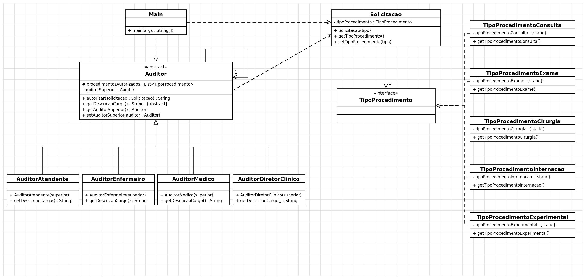

# Padrão Chain of Responsibility — Autorização de Procedimentos Médicos


## Diagrama UML


(gerado por `docs/gerar_uml.py`)


## Executar
```
mvn test
mvn compile exec:java -Dexec.mainClass=padroescomportamentais.chainofresponsability.Main
```
Requer JDK 11+ e Maven. No IntelliJ: *File > Open* e escolha a pasta (ou o `pom.xml`).
